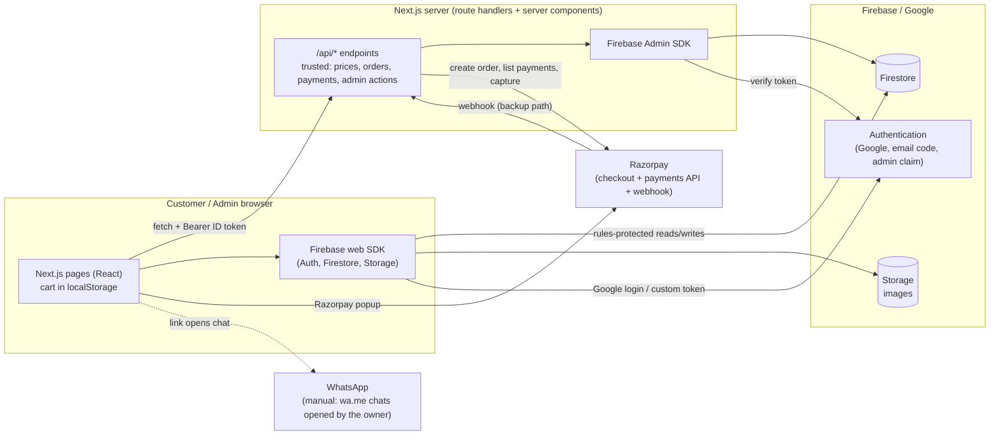
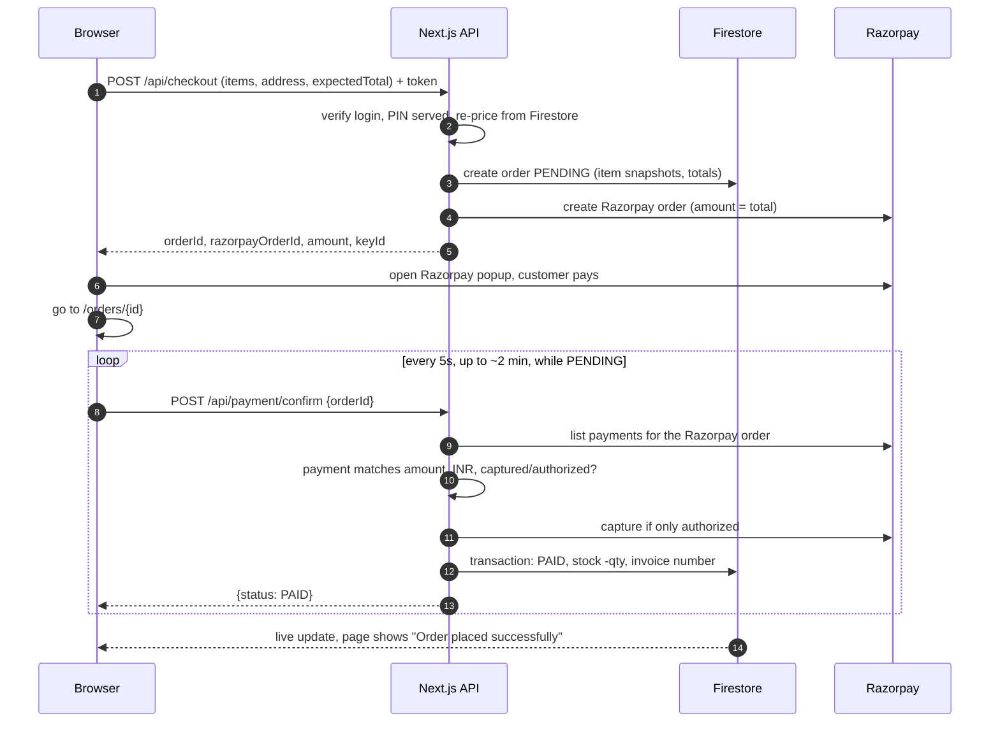
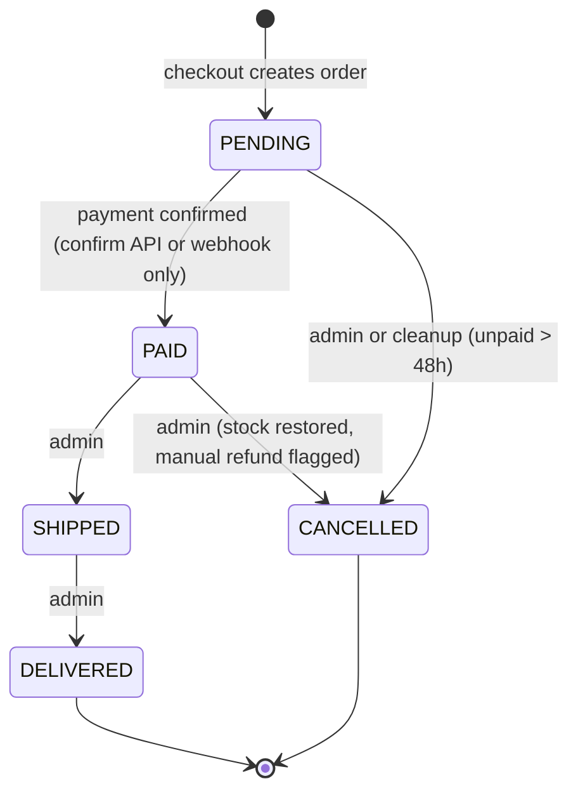

# RS Jewellers: System Architecture and API Guide

How the system is put together and how every API behaves. For "which file do I open when X breaks" see `PROJECT_MAP.md`.

Status: describes the code as written. Milestones M0 to M8 were verified locally by the owner. M9 (automatic payment confirmation) and M10 (new theme) are written and awaiting local confirmation. Sections marked **Proposed** are not built.

---

## 1. The big picture



**Three ideas hold it together**
1. **Two data paths.** Anything involving money, stock, or admin power goes through the server (`/api/*`), which uses the Firebase Admin SDK and can't be tampered with from the browser. Harmless per-user data (wishlist, support chat, return requests) goes straight from the browser to Firestore, guarded by `firestore.rules`.
2. **The server is the only source of truth for prices and payment status.** The browser never sends a price and can never mark an order paid.
3. **Realtime by default.** Order status, admin lists, gold-rate bar and chat use Firestore live listeners, so screens update without refreshing.

---

## 2. Layers and responsibilities

| Layer | Where | Responsibility |
|---|---|---|
| Presentation | `src/app/**/page.tsx`, `src/components/` | Pages and UI. Server components read the catalogue; client components handle login, cart, forms, live data |
| API (trusted) | `src/app/api/**/route.ts` | Validate input, check login/admin, apply business rules, talk to Razorpay, write orders |
| Business logic | `src/lib/*.ts` (pure, unit-tested) | Pricing, validation, payment matching, invoice numbers, admin rules |
| Server services | `src/server/*.ts` | Admin SDK connection, catalogue reads, the PAID and status transactions |
| Data + security | Firestore, Storage, `firestore.rules`, `storage.rules` | Persistence and last-line access control |
| External | Razorpay, Firebase Auth | Payments; identity (Google and emailed login codes) |

### Which operations use which path

| Server path (`/api/*`) | Direct browser-to-Firestore path (rules-guarded) |
|---|---|
| Price quotes, checkout, payment confirmation, webhook | Profile, wishlist (`users/{uid}`) |
| Admin: gold rates, product create/edit/delete, order status (single and bulk), cleanup | Custom-design inquiry create (customer), quote/status (admin) |
| | Return request create (customer), review (admin) |
| | Support chat messages (customer and admin) |
| | Admin: PIN codes, policy text, low-stock threshold |
| | All reads for live screens (own orders, admin lists, rates) |

---

## 3. Identity and access

**Login:** **Google sign-in**, or a **6-digit code emailed to the customer** (no password, no SMS, so no per-login cost). Firebase has no built-in email-code login, so the server does it: `POST /api/otp/send` creates a code, stores only a keyed hash with a 10-minute expiry, and emails it through Resend; `POST /api/otp/verify` checks the code (5 wrong guesses per code, single use) and returns a Firebase **custom token**, which the browser exchanges with `signInWithCustomToken`. A person who used the same email with Google is matched to the same Firebase user. Either way the browser then holds a signed **ID token**. Phone OTP still exists in the code (`src/components/phone-login.tsx`) but is switched off by `NEXT_PUBLIC_ENABLE_PHONE_LOGIN`. A customer's phone number is collected at checkout and on the inquiry form, because the owner contacts customers on WhatsApp by hand.

**Calling the API:** protected endpoints require `Authorization: Bearer <ID token>`. The server verifies it with the Admin SDK (`verifyIdToken`). Tokens are short-lived and refreshed by the SDK.

**Admin:** a Firebase custom claim `admin: true`, granted by `scripts/set-admin.ts`. It is enforced three times:
1. Browser gate: `src/app/admin/layout.tsx` (usability only, not security).
2. Server: `src/server/admin-auth.ts` (`requireAdmin`) on every `/api/admin/*` route.
3. Database: `isAdmin()` in `firestore.rules` and `storage.rules`.

| Actor | Can |
|---|---|
| Guest | Browse catalogue, see gold rates, get price quotes, read policy pages |
| Customer | Everything above + checkout, see own orders, wishlist, returns, support chat, custom-design inquiries |
| Admin | Everything above for all customers + manage products, rates, orders, PIN codes, policies, returns, support |
| Server only | Create orders, mark PAID, change stock, write invoice counters |

---

## 4. Pricing engine (`src/lib/pricing.ts`)

All money is **integer paise**; weight is **integer milligrams**; percentages are **basis points** (1200 = 12%).

```
metal    = round(weight_mg × rate_paise_per_g / 1000)
making   = percent:  round(metal × bps / 10000)      or flat amount
subtotal = metal + making + stone          (a fixed-price product uses its fixed price instead)
gst      = round(subtotal × gst_bps / 10000)
total    = subtotal + gst
```
Worked example (0.62 g, 22K at ₹11,900/g, 12% making, 3% GST): metal ₹7,378.00, making ₹885.36, subtotal ₹8,263.36, GST ₹247.90, **total ₹8,511.26**.

The customer sees only the final price. The full breakdown is stored on each order (rate used, metal, making, GST) so later rate changes never alter old orders.

---

## 5. Key flows

### 5.1 Purchase and payment confirmation


Backup path: Razorpay can also call `POST /api/webhooks/razorpay` (signed). It ends in the same transaction, which does nothing if the order is already paid, so stock and invoice numbers are never applied twice.

### 5.2 Fulfilment
Admin sees the paid order live (chime), opens the order, enters carrier and tracking, and marks it shipped (`POST /api/admin/orders/{id}/status`). The owner then sends the customer a WhatsApp update by hand, using the ready-written message behind the "Send WhatsApp update" button.

### 5.3 Gold-rate change
Admin saves rates (`POST /api/admin/rates`). The server writes `settings/pricing` and an audit row. Every visitor's gold-rate bar updates live. Prices follow the new rate immediately; orders already placed keep theirs.

---

## 6. Order state machine


Only the payment-confirmation code can create the PENDING to PAID transition. The rules for the others live in `canTransition` (`src/lib/admin-logic.ts`) and run inside a database transaction (`changeOrderStatus`).

---

## 7. API reference

Conventions: JSON in and out. Errors are `{ "error": "message" }` with a suitable HTTP status. `Auth` means `Authorization: Bearer <Firebase ID token>`. Rate limits are in memory per server instance.

### 7.1 Public

**`POST /api/quote`**: live prices for a list of products (cart and wishlist display).
- Auth: none. Limit: 60 per minute per IP.
- Request: `{ "items": [{ "productId": "ring-petal", "qty": 1 }] }` (1 to 20 items, qty 1 to 10)
- Response 200: `{ "lines": [{ "productId", "qty", "name", "purity", "netWeightMg", "unit": {…price parts…}, "lineTotalPaise", "error"? }], "ok": true, "totalPaise": 851126 }`. A line carries `error` (for example "Only 2 left") instead of a price when it can't be bought.
- Errors: 400 invalid items, 429 too many requests.
- Code: `src/app/api/quote/route.ts`, `src/server/catalog.ts` (`quoteItems`).

### 7.1b Login codes (public)

**`POST /api/otp/send`**: emails a 6-digit login code.
- Auth: none. Limits: 10 per 10 minutes per IP; per email 30 seconds between codes and 5 codes an hour (kept in the database, so they hold across server instances).
- Request: `{ "email": "asha@example.com" }`. Response 200: `{ "ok": true }` (identical whether or not the email has an account).
- Errors: 400 invalid email; 429 too many requests or "wait N seconds" with `retryAfterSec`; 502 email provider failed (the code is discarded so the customer can retry); 503 not configured.
- Code: `src/app/api/otp/send/route.ts`, `src/lib/otp.ts`, `src/server/email.ts`.

**`POST /api/otp/verify`**: checks the code and signs the customer in.
- Auth: none. Limit: 20 per 10 minutes per IP.
- Request: `{ "email", "code": "123456" }`. Response 200: `{ "token": "<Firebase custom token>" }`.
- Errors: 400 wrong code, or expired / none requested; 429 five wrong guesses (a new code is needed) or too many requests; 500 sign-in failed.
- Safe by design: the code is stored only as a keyed hash, is single use, is tied to the email, and is compared in constant time.
- Code: `src/app/api/otp/verify/route.ts`.

### 7.1c Admin permission sync (login required)

**`POST /api/auth/sync-admin`**: keeps the admin permission in step with the server's private `ADMIN_EMAILS` list. The admin screens call it when they open, then refresh the login token.
- Auth: required. Limit: 30 per minute per user.
- Rules: a **verified** email on the list is granted admin (marked `adminVia: "allowlist"`); an allowlist-granted admin whose email is removed from the list loses it; admins made by the local `set-admin` script are never withdrawn; an **empty list does nothing**, so a mistake can never lock everyone out.
- Response 200: `{ "admin": true | false, "changed": true | false }`. Errors: 401, 429, 500.
- Code: `src/app/api/auth/sync-admin/route.ts`, `adminSyncDecision` in `src/lib/admin-logic.ts`.

### 7.2 Customer (login required)

**`POST /api/checkout`**: starts a purchase.
- Auth: required. Limit: 10 per minute per user.
- Request: `{ "items": [{productId, qty}], "address": { name, phone, line1, line2, city, state, pincode }, "expectedTotalPaise"?: 851126 }`
- What it does: verify login → validate input → check the PIN code is serviceable → load product prices → price the cart (rejects inactive, out of stock) → compare `expectedTotalPaise` → create a `PENDING` order → create the Razorpay order.
- Response 200: `{ "orderId", "razorpayOrderId", "amount", "currency": "INR", "keyId" }`
- Errors: 401 not logged in; 400 invalid address, PIN not served, total under ₹1; **409 `PRICE_CHANGED`** with the new `totalPaise` (the gold rate moved: show the new total and ask again); 409 cart problem; 429; 502 Razorpay failed (the pending order is removed); 503 payments not configured.
- Code: `src/app/api/checkout/route.ts`.

**`POST /api/payment/confirm`**: asks Razorpay whether the order was paid and, if so, completes it.
- Auth: required (the order must belong to the caller). Limit: 30 per minute per user.
- Request: `{ "orderId": "<our order id>" }`
- Behaviour: returns immediately if already paid. Otherwise lists the payments on the Razorpay order and accepts only one with the same order, same amount, INR, and status captured (or authorized, which the server then captures). Then runs the PAID transaction.
- Response 200: `{ "status": "PAID" }`, `{ "status": "PENDING", "reason": "NO_PAYMENT" | "ERROR" }` (not paid yet or a temporary error, ask again; extra `seen` and `detail` fields appear only outside production), 503 `reason: "KEYS_MISSING"` when Razorpay keys are not set, `{ "status": "REVIEW" }` (paid but flagged for the owner), or the order's current status.
- Errors: 401, 400, 404 (unknown or not yours), 429, 503.
- Idempotent: safe to call repeatedly; never double-reduces stock.
- Code: `src/app/api/payment/confirm/route.ts`, `src/lib/webhook.ts` (`pickPayment`), `src/server/orders.ts` (`markOrderPaid`).

### 7.3 Razorpay-facing

**`POST /api/webhooks/razorpay`**: backup confirmation pushed by Razorpay (needs a public URL).
- Auth: header `x-razorpay-signature` = HMAC-SHA256 of the **raw** body with `RAZORPAY_WEBHOOK_SECRET` (constant-time compare).
- Handles `payment.captured` only; other events get `{ ok: true, ignored: true }`.
- Checks that the Razorpay order id, amount and currency match our order, then runs the same PAID transaction.
- Response 200: `{ "ok": true, "result": "PAID" | "ALREADY_DONE" | "NEEDS_REVIEW" | "MISMATCH" | "NOT_FOUND" }`. 400 bad signature or JSON. **500 on internal failure so Razorpay retries.**
- Code: `src/app/api/webhooks/razorpay/route.ts`.

### 7.4 Admin (all require the `admin` claim: 401 not logged in, 403 not admin)

| Endpoint | Request | Response and notes |
|---|---|---|
| `POST /api/admin/rates` | `{ rate18k, rate22k, rate24k, gstPercent, confirmLargeChange? }` (rupees as text, GST as percent) | `{ ok: true }`. Rejects rates outside ₹100 to ₹1,00,000 per gram, or not ordered 24K > 22K > 18K. A change over 20% returns **409 `CONFIRM_LARGE_CHANGE`** until resent with `confirmLargeChange: true`. Writes an audit row |
| `POST /api/admin/products` | `{ id, name, category, description, purity, netWeightMg, makingType, makingValue, stonePaise, fixedPricePaise, stock, active, images[], highlights[], specs[] }` | `{ ok: true }`. 409 if the id exists. Images are uploaded to Storage by the browser first; this stores their links |
| `PATCH /api/admin/products/{id}` | Full product (has `name`) or quick `{ active?, stock? }` | `{ ok: true }`; 404 unknown product |
| `DELETE /api/admin/products/{id}` | none | `{ ok: true }`. Past orders keep their own item snapshot |
| `POST /api/admin/orders/{id}/status` | `{ status, tracking?, carrier? }` | `{ ok: true }`. 409 if the move is not allowed. Cancelling a paid order restores stock and sets `refundPending` |
| `POST /api/admin/orders/bulk` | `{ ids: [≤50], status }` | `{ ok: true, results: [{ id, ok, error? }] }`; orders that can't make the move are skipped, not failed |
| `POST /api/admin/orders/cleanup` | none | `{ ok: true, cancelled: n }`. Cancels unpaid orders older than 48 hours |

Code: `src/app/api/admin/**/route.ts`, rules in `src/lib/admin-logic.ts`, transaction in `src/server/orders.ts`.

### 7.5 Direct Firestore operations (no API; protected by `firestore.rules`)

| Operation | Who | Rule highlights |
|---|---|---|
| Read `products`, `settings/*` | Anyone | Inactive products hidden from non-admins |
| Read own `orders` | Owner, admin | Nobody can create or delete orders from the browser; admin may change only status, tracking, carrier |
| `users/{uid}` profile and wishlist | Owner | Only your own document |
| `custom_inquiries` create | Customer | Must be your own uid, status `NEW`, description up to 2000 characters |
| `returns/{orderId}` create | Customer | One per order, your own **DELIVERED** order, reason 10 to 1000 characters; admin can only change status and note |
| `support_threads/{uid}` + `messages` | Customer / admin | Customers write `from: customer` in their own thread; admin writes `from: admin`; messages are immutable |
| `settings/service` (PIN codes), `settings/legal` (policies), `settings/store` | Admin | Admin-only writes |

Storage: `products/` (admin writes, public reads); `custom_inquiries/{uid}/` (owner writes JPG/PNG/WebP under 5 MB; owner and admin read).

---

## 8. Data model

| Collection | Key fields |
|---|---|
| `products/{id}` | name, category, description, highlights[], specs[], purity, netWeightMg, makingType/makingValue, stonePaise, fixedPricePaise (null = live rate), stock, active, images[] |
| `settings/pricing` | rate18k/22k/24kPaisePerGram, gstBps, updatedAt, updatedBy; subcollection `rateHistory` |
| `settings/service` | pincodes[] (empty = deliver everywhere) |
| `settings/legal` | terms, privacy, shipping, returns, cancellation (text) |
| `settings/store` | lowStockThreshold |
| `orders/{id}` | uid, phone, items[] (name, purity, weight, qty, price breakdown), totalPaise, gstPaise, address, status, payment{razorpayOrderId, paymentId}, invoiceNo, paidAt, carrier, tracking, needsReview/reviewReason, refundPending |
| `counters/invoice-<FY>` | last (server only; drives invoice numbers like `RS/2627/000001`) |
| `users/{uid}` | phone, name, wishlist[], joinedAt, lastLoginAt |
| `custom_inquiries/{id}` | uid, name, phone, description, imagePaths[], status, quotedPaise |
| `returns/{orderId}` | uid, type (RETURN or EXCHANGE), reason, status, adminNote |
| `email_otps/{hash of email}` | codeHash (keyed hash, never the code), expiresAt, attempts, lastSentAt, windowStart, sendCount. Server only |
| `support_threads/{uid}` and `/messages/{id}` | thread: name, status, lastMessageAt, unreadAdmin; message: from, text, at |

**Invariants the code protects:** an order's prices never change after creation; stock moves only when an order becomes paid or a paid order is cancelled; each paid order gets exactly one invoice number; a payment is accepted only if order, amount and currency all match.

---

## 9. Failure handling

| Situation | What happens |
|---|---|
| Gold rate changes while the customer is paying | Checkout returns 409 `PRICE_CHANGED`; customer sees the new total and confirms again |
| Customer closes the tab after paying | The order page resumes the payment check when reopened; the webhook (once hosted) also catches it |
| Payment arrives twice (confirm + webhook, or replays) | The transaction sees the order is already paid and does nothing |
| Paid, but the product sold out meanwhile | Order is still marked paid (money received), stock set to 0, flagged `STOCK_SHORTFALL` for the owner |
| Payment arrives for a cancelled order | Flagged `PAID_AFTER_CANCEL` for review |
| Payment amount or order id mismatch | Flagged `PAYMENT_MISMATCH`; never marked paid |
| Razorpay down while creating the order | The pending order is deleted and the customer is told to retry (502) |
| Abandoned unpaid orders | Admin can cancel those older than 48 hours |

---

## 10. Environments and configuration

| | Local (today) | Production (to do) |
|---|---|---|
| Firebase | Emulators (project `demo-rs-jewellers`); `npm run seed` loads sample data | Real project on the Blaze plan; Firestore and Storage created; rules deployed; service-account key or platform credentials for the server |
| Login | Emulator (fake Google popup); the emailed code is printed in the `npm run dev` terminal | Google provider enabled, domain authorised; Resend with a verified sending domain; `OTP_SECRET` set; the server's Google service account allowed to sign tokens (see section 12) |
| Razorpay | Test keys | Live keys after business KYC; live webhook URL |
| Hosting | `npm run dev` | **Firebase App Hosting** in Singapore (`asia-southeast1`); see section 12 and `DEPLOYMENT.md` |

Environment variables are listed in `PROJECT_MAP.md` section 6. `NEXT_PUBLIC_*` values are visible to the browser; never place a secret in one.

**Decided against:** WhatsApp OTP and paid SMS login. If phone login is wanted later, switch the flag on and use Firebase SMS (paid per message).

---

## 11. Security controls

- Prices and payment status decided only on the server; the browser input is never trusted.
- Webhook signature verified over the raw body with a constant-time comparison.
- Admin power checked in the UI, the API and the database rules.
- Orders, invoice counters and stock cannot be written from the browser.
- Input validated on every endpoint (`src/lib/validate.ts`, `src/lib/admin-logic.ts`); CSV exports neutralise spreadsheet formulas.
- Rate limits on quote, checkout and payment confirmation.
- Security headers in `next.config.ts`; image uploads limited by type and size.
- Dependency advisories reviewed; only moderate `uuid` notices inside Google libraries remain.

**Known limits:** rate limits are per server instance (a shared limiter is needed if several instances run); the admin dashboards load the latest 500 orders; the owner must watch the admin Orders page to see new orders (a push notification could be added later); hallmarking, GST registration and policy wording are business decisions outside the code.

---

## 12. Hosting: Firebase App Hosting (chosen)

App Hosting is **not offered in Mumbai**; its supported regions are Taiwan, Singapore, the Netherlands, Iowa, Northern Virginia and Columbus. Singapore is the closest to India, so the backend, Firestore and Storage all use `asia-southeast1`. Step by step: `DEPLOYMENT.md`.

Options considered:

| | Firebase App Hosting | Vercel | Own server (VPS) | Cloudflare (OpenNext) |
|---|---|---|---|---|
| Plan needed | Firebase Blaze (already needed for Storage) | **Pro, about $20 per seat per month** (the free plan forbids commercial use) | A rented small server; you run it | Cloudflare Workers paid or free tier |
| Free allowance | 10 GiB bandwidth, 180k vCPU-seconds, 360k GiB-seconds per month, then pay per use | Pro includes 1 TB transfer | Fixed monthly price | Per Cloudflare plan |
| Setup speed | Medium: GitHub connection plus an `apphosting.yaml` | **Fastest** | Slowest: install, HTTPS, updates, backups | Medium; adapter needed |
| Fit with this app | Good: same Google project; Next.js 15 supported; scales to zero (first visit after idle is slower) | Good: native Next.js caching and preview links | Good: plain Node server | **Unverified** for `firebase-admin`; not recommended without a test |
| Main risk | Cache refresh across several instances unconfirmed | Monthly fee | You maintain security and uptime | Compatibility |

**Things to do when deploying to App Hosting**
- Keep `OTP_SECRET`, `RESEND_API_KEY`, Razorpay keys and similar values as secrets (App Hosting reads them from Google Secret Manager through `apphosting.yaml`).
- **Admins in production:** the `admin-emails` secret (a comma-separated list) makes those verified emails admin automatically after login. No key file or script is needed on the live site.
- **Login codes sign users in with a custom token.** On Google's servers without a key file, the app's service account must be allowed to sign tokens (the "Service Account Token Creator" role on itself). Without it, `/api/otp/verify` returns 500. I believe this is required but have not tested it; check it first on a test project.
- The in-memory rate limiter is per instance. Keep the maximum instances low, or add a shared limiter, before heavy traffic.
- Resend free plan: 100 emails a day, shared by login codes and any other email. Check your volume.
